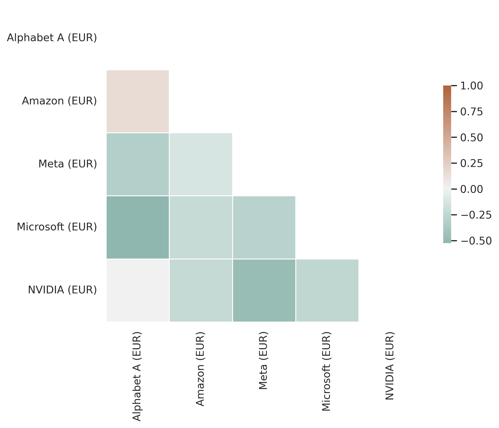
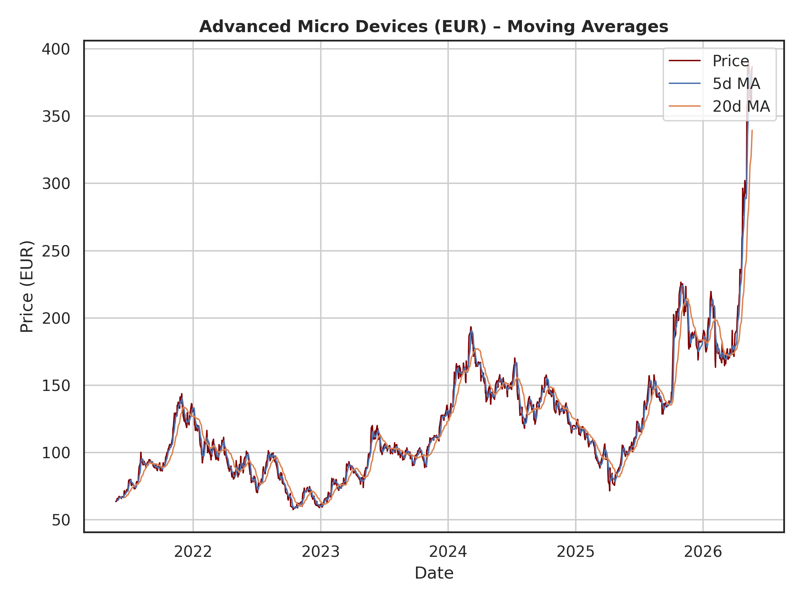
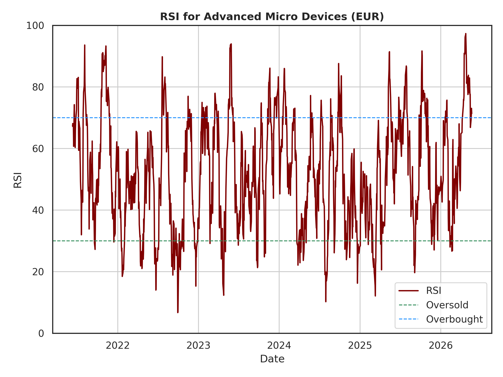
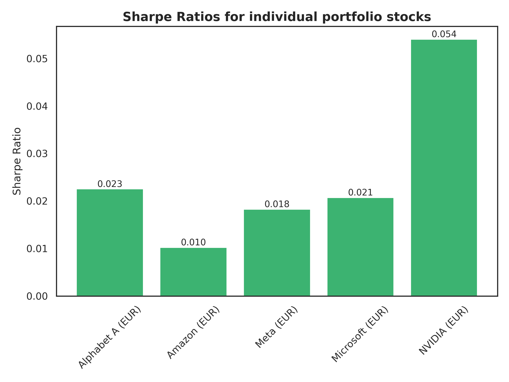
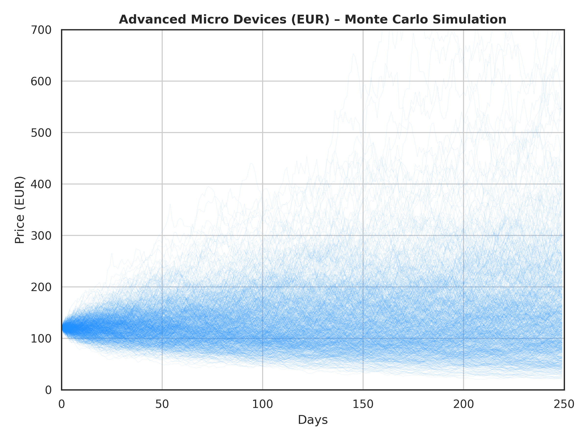
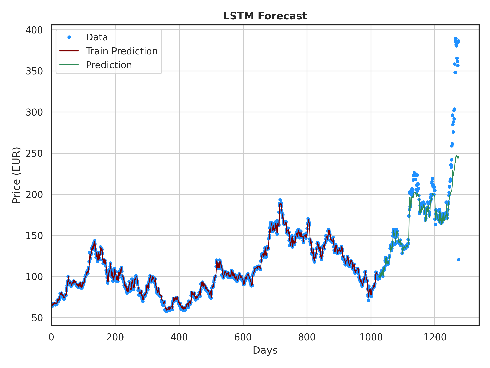

# StkView: Quantitative Stock Analysis & Predictive Modeling

[](https://www.python.org/)
[](https://pytorch.org/)
[](https://pandas.pydata.org/)
[](https://github.cUnlicense)

**StkView** is a comprehensive financial analysis pipeline designed to transform raw stock market data into actionable quantitative insights. The project integrates traditional statistical risk metrics, technical analysis indicators, and deep learning-based price forecasting.

## Overview

The goal of StkView is to provide a robust framework for evaluating portfolio risk and predicting short-term price movements. The pipeline covers the entire data lifecycle: 
from ingestion and cleaning to advanced predictive modeling.

### Key Features
- **Automated Data Pipeline:** Robust preprocessing of CSV-based historical stock data, including outlier detection and imputation.
- **Portfolio Risk Management:** Calculation of historical volatility and **Value at Risk (VaR)** for diversified portfolios.
- **Technical Analysis Suite:** Implementation of Moving Averages, **Relative Strength Index (RSI)**, and **Sharpe Ratio**.
- **Probabilistic Forecasting:** Monte Carlo simulations to project future price distributions.
- **Deep Learning Predictor:** A **Long Short-Term Memory (LSTM)** neural network implemented in PyTorch for short-term trend forecasting.

---

## Technical Deep Dive

### 1. Data Engineering & Preprocessing
To ensure high data quality, StkView implements a multi-stage cleaning process:
* **Type Casting & Normalization:** Handles locale-specific formatting (e.g., converting comma-separated thousands to floats).
* **Outlier Correction:** A custom heuristic function identifies and corrects data inflation errors.
* **Data Integrity:** Implements missing-value imputation and drops incomplete features to maintain statistical validity.
* **Descriptive Analytics:** Automated generation of baseline statistics (mean, std, min, max).

### 2. Quantitative Analysis & Risk Metrics
The project transitions from single-asset analysis to portfolio theory:
* **Portfolio Construction:** Dynamic weighting of assets (configured via external input files).
* **Risk Quantification:** 
    * **Volatility:** Annualized standard deviation of daily returns.
    * **Value at Risk (VaR):** Quantifies the maximum expected loss over a specific horizon at a given confidence level.
* **Visualization:** Heatmaps for portfolio correlation and risk distribution.

### 3. Technical Indicators & Simulations
For deep-dives into specific assets (e.g., AMD), the system calculates:
* **Momentum Indicators:** RSI to detect overbought/oversold conditions.
* **Risk-Adjusted Return:** The Sharpe Ratio to evaluate the excess return per unit of deviation.
* **Monte Carlo Simulation:** A stochastic model running 250-day projections to visualize the probability density of future prices.

### 4. Predictive Modeling (LSTM)
The project employs a Recurrent Neural Network (RNN) architecture:
* **Model:** LSTM (Long Short-Term Memory) to capture long-term temporal dependencies.
* **Windowing:** Uses a sliding window of 4 days of historical data as input features.
* **Training:** 80/20 train-test split with PyTorch, focusing on trend capturing and MSE minimization.

## Analysis & Visualizations

This section showcases the quantitative outputs of the StkView pipeline, focusing on AMD as a primary case study.



**Figure 1:** Heatmap for constructed portfolio.



**Figure 2:** MA plots for AMD.



**Figure 3:** RSI analysis for AMD, highlighting momentum shifts.



**Figure 4:** Risk-adjusted performance comparison via Sharpe Ratio.



**Figure 5:** 250-day price projection showing the probability density of outcomes.



**Figure 6:** LSTM model performance: Predicted price trajectory vs. actual market data.

---

## Project Structure

```text
├── data/               # Raw and processed stock CSVs
├── input/              # Configuration files (Portfolio weights, tickers)
├── output/             # Generated plots and analysis reports
├── README.md           # This file
├── requirements.txt    # Dependency list
├── StkView.py          # Main execution engine
└── LICENSE             # Unlicense
```

## License

This project is licensed under the Unlicense - see the LICENSE file for details

© 2026 Markus Schindler

